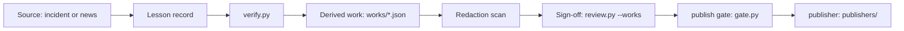
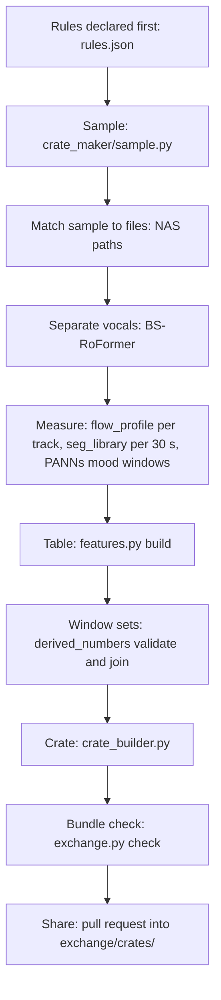
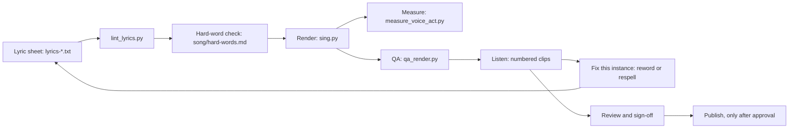

# The pipelines: lessons, analysis and composition

Three loops share one rule: a person decides what is published, numbers can be shared, and text stays local until it is approved.

- **Lesson loop** (this repo, built): turns a lesson into a reviewed derived work.
- **Analysis loop** (this repo for the crate tools; the measuring scripts are local): turns a library into measured crates.
- **Composition loop** (`compose/` in this repo; needs a speech server and audio libraries): turns a lyric sheet into a checked render.

Status key: **built** = code and tests exist here; **run** = used on real data by the maintainer (not yet tried on your setup); **planned** = designed, not built; **manual** = a person does it.

## 1. Lesson loop



| Stage | Tool | Input | Output | Status |
|---|---|---|---|---|
| Source | adapters (Outline first) | incident, news | lesson record | planned for news; incidents built as examples |
| Record | `schema/lesson-record.schema.json`, `records/` | the record | a checked record | built |
| Verify | `verify.py` | records, works, feedback | ok or errors (schema, redaction by value, evidence) | built, run |
| Derive | `schema/derived-work.schema.json`, `works/` | approved lessons | a work naming them | built, run (seven song works) |
| Redact | `verify.py` on works | the work text | `redaction.status` | built, run |
| Sign-off | `review.py --works` | a named person at a terminal | `signoff` block | built; manual |
| Publish gate | `gate.py` | approved and verified items | the items allowed out | built |
| Publish | `publish.py`, `publishers/static-site` | gated items | one HTML page | built |

Rules that hold at every stage: the approver's name comes from the platform or the terminal, never from a model; sign-off has one write path (`set_signoff`); a work cannot be approved while its redaction is pending or while a lesson it names is unapproved (decision 23, `docs/signing-off-works.md`).

## 2. Analysis loop: library to crate



| Stage | Tool | Input | Output | Status |
|---|---|---|---|---|
| Declare rules | `mood-rules.json` (seed, duration window, per-artist cap, sides) | your decisions, before any audio | rules hash | run |
| Sample | `crate_maker/sample.py` | library listing (artist, title, duration, tags) | `sample.json`, `assign.json` (opaque ids, one pick per track) | built, run (duplicate-id fix committed) |
| Match files | local scripts over the NAS | sample ids | a path per track | run; mismatches fixed by hand, excluded sections left out |
| Separate | `audio-separator` with BS-RoFormer (GPU) | the full track | `vocals.wav` | run (262 tracks); decode fallback via ffmpeg for WMA |
| Measure per track | `flow_profile.profile()` (RMVPE pitch, speech-server word count) | vocal stem | one row of numbers | run (263 tracks) |
| Measure per window | `seg_library.py` | vocal stem, 30 s windows | pace and spread per window | run |
| Mood per window | `tag_windows.py` (PANNs CNN14, CPU) | the full track | seven mood values per 30 s | run |
| Table | `features.py build flow-tsv` | per-track TSV | validated feature table with provenance | built, run |
| Window sets | `derived/derived_numbers.py` | window rows | validated, joined sets | built, run |
| Crate | `crate_builder.py build` | table, assignment with sides `s1`, `s2` | crate JSON: separability, carriers, evidence tier | built, run (two crates on main) |
| Bundle check | `exchange.py check` | a folder of crate JSON | counts and a pass or fail | built, run |
| Share | pull request | checked bundle | `exchange/crates/` | run |

What the crate says, and what it does not: the sides are defined by tags, so a crate describes how a tag group differs in delivery, not a fact about the music. Tracks by one artist are not independent, so the group effect is the one that counts. Analyzer calibration is "none" for these tables. A small crate is a hypothesis. The two crates on main share one library, so their agreement is not an independent replication.

## 3. Composition loop: sheet to checked render (`compose/`)



| Stage | Tool | What it checks or does | Status |
|---|---|---|---|
| Sheet | `lyrics-*.txt` with `@voice`, `(slot ...)`, `(break N)` tags | the lyric and the voices per line | built |
| Lint | `compose/lint_lyrics.py` | lines too long for their slot (LONG), heteronym marks | built, run |
| Hard words | `hard-words.md` (your own list) | words the engine handled badly | manual; in use |
| Rhyme check | `compose/rhyme_check.py` (entropy-weighted density, whole sheet, against the hip-hop text reference) | how rhyme-heavy the whole sheet is, against 598 hip-hop songs (text only) | built, run; diagnostic, not a gate; short sections are not compared |
| Render | `compose/sing.py` (Kokoro through the speech server, fit to the beat, persona beat, mix) | a stereo mix and stems | built, run |
| Render options | `--beat-gain`, `--hook-lift`, `--flatten` (needs pyworld), `--tail-soften`, `--legato` | level, hook lift, pitch movement, word ends, run length | built; tail option added 2026-11-18 |
| Measure | `compose/measure_voice_act.py` | pace (heard syllables per active second), spread, span | built, run |
| QA | `compose/qa_render.py` | word mismatches (recognizer against sheet), line-end hiss, backing against voice, clipping | built, run; flags for a listen, not a verdict |
| Listen | numbered clips from the mix | a person hears the flagged spots | manual |
| Fix | reword or respell that line only | one instance at a time | manual |
| Review | the work file, `review.py --works` | a named person approves | manual; see `docs/signing-off-works.md` |

### Adopting this without the local tools

The composition loop's scripts are in `compose/` (see its README for dependencies and settings) but are not required. What the repo needs from any
composition tool is a work file in `works/` that passes `verify.py --all`; how the text was made does not matter. Swap in
your own writer and renderer, keep the checks you trust, and keep the stages after the sheet (redaction scan, human
sign-off, gate, publish) as they are.

## Try the built stages yourself

Stdlib only, offline, no tokens:

```bash
python3 -I -m unittest discover -s tests
python3 verify.py --all
python3 -I exchange.py check
python3 review.py show practice-sign-off --works
```

CI (`.github/workflows/ci.yml`) runs the first, second and third on every push and pull request; run them by hand anywhere else. Set `MCSOC_INTERNAL_DOMAINS` (comma-separated) so the published page never links your own internal hosts.

## Known limits (compose side)

- The speech model sometimes turns a word-final stop into its voiced cousin (conflict heard as "confligd"). Reword, do not add a general rule.
- Long words with mid-word stress in short slots can be heard as other words.
- The beat level is set by a rough measure (about 3.7 dB backing over voice). The QA balance flags are rough, not a mix review.
- The rhyme measures use a simple matcher, not the learned model from the published work; that model is planned, not built.
- Separation and recognition errors are inherited by every measure built on them.

## Where the decisions are

- Review surface contract: `docs/design.md`, decision 13.
- Derived works and their sign-off: decisions 8 and 23.
- Provenance on every table: decision 15.
- Crates and their replication: decisions 16 and 17.
